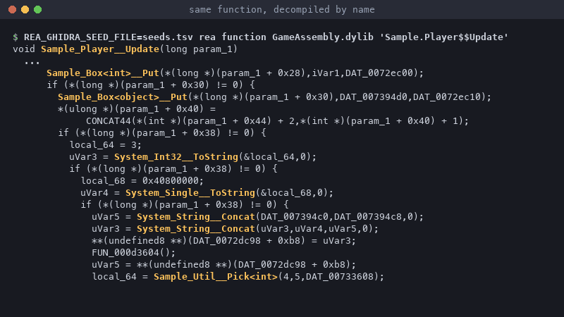
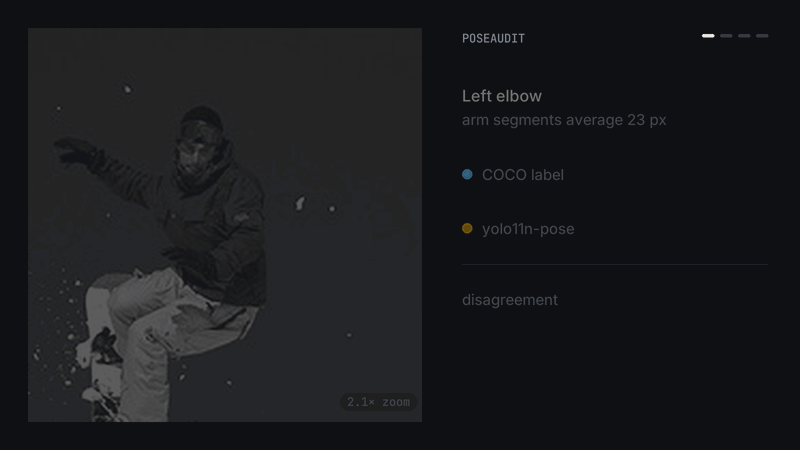
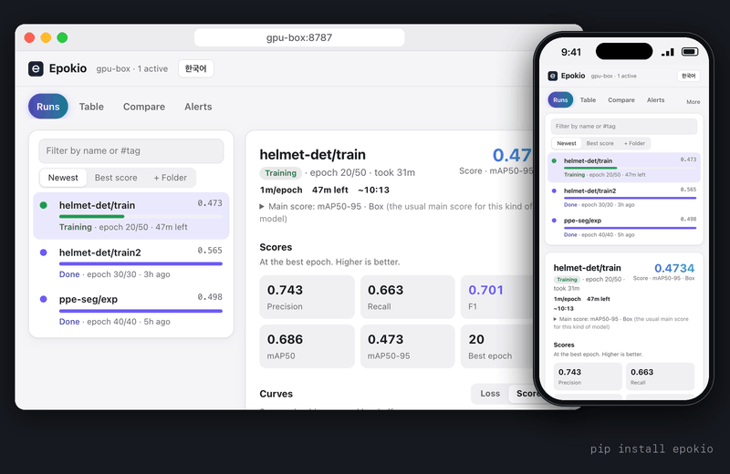
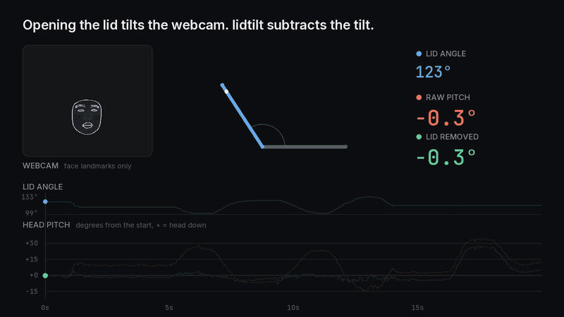
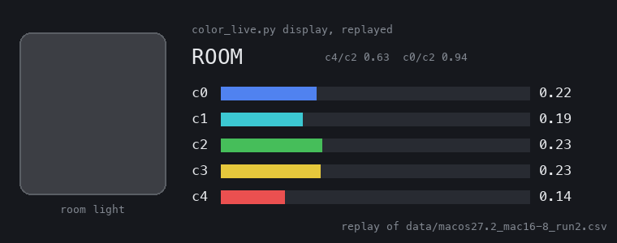
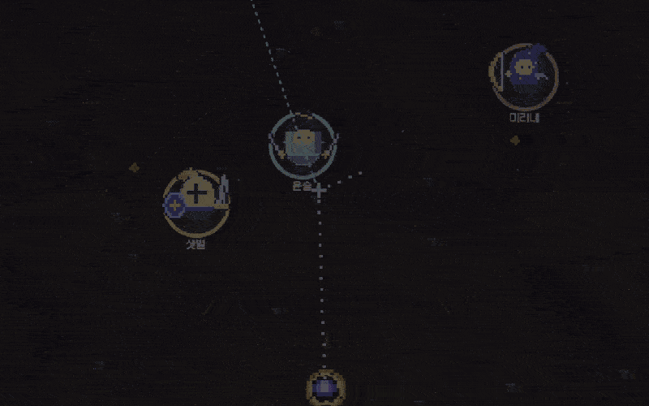
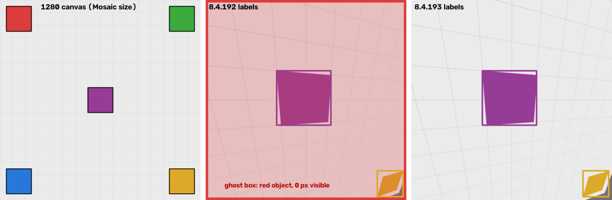

## Hi, I'm Byungkun Jang 👋

**Software engineer (new grad · Seoul · open to remote).** I build Unity IL2CPP reverse-engineering support and check the measurements behind pose-estimation tools.

- Wrote the original **Unity IL2CPP** support in **[rea](https://github.com/morluto/rea)** (reverse-engineering toolkit); it shipped in **6.8.0**
- **31 merged PRs** in 14 external open-source repos (as of Nov 2026): rea 9 · Ultralytics 4 · SurfSense 3 · supervision 2 · RF-DETR 2 · 11 more in 9 other repos ([list](https://github.com/search?q=is%3Apr+author%3A8rulerstar+is%3Amerged+-user%3A8rulerstar&type=pullrequests)). Not counted: my own repos.
- Wrote the first version of supervision's **COCO keypoint mAP** metric, which the maintainer extended and shipped in **0.31.0**
- Author of **[poseaudit](https://github.com/8rulerstar/poseaudit)** and **[Epokio](https://github.com/8rulerstar/epokio)** (both on PyPI)

📧 bkbkjang@gmail.com · 🎮 [itch.io](https://8rulerstar.itch.io)

🇰🇷 한국어 요약

- 리버스 엔지니어링 도구 **rea**에 Unity(IL2CPP) 게임 분석 기능(원본 구현)을 기여해 머지됐고, 6.8.0에 릴리스됐습니다. 두 사용자가 각자의 상용 빌드로 검증했고, Windows 빌드에서 Il2CppDumper와 제네릭을 제외한 메서드 이름 11만여 개가 차이 없이 일치했습니다.
- AI 라이브러리 <b>YOLO(Ultralytics)</b>와 <b>Roboflow supervision</b>에 PR이 머지됐습니다. (외부 저장소 14곳 머지 31건(2026년 11월 기준): rea 9 · Ultralytics 4 · SurfSense 3 · supervision 2 · 기타. 본인 저장소 제외)
- Roboflow supervision의 **COCO keypoint mAP** 지표 첫 버전을 작성했고, 메인테이너가 확장해 0.31.0의 대표 기능 중 하나로 출시됐습니다.
- YOLO(Ultralytics)의 **COCO 변환기**(`convert_coco`)가 키포인트 없는 사람을 남겨 자세 인식 점수가 실제보다 낮게 나오던 문제를 찾아 pycocotools와 비교해 재현했고, 이를 근거로 메인테이너가 변환기 한 줄로 고쳤습니다. (공식 COCO pose 점수는 영향 없음)
- 자세 인식 측정값을 점검하는 **poseaudit**, 모델 학습이 멈추면 휴대폰으로 알려주는 **Epokio**를 만들어 공개 배포했습니다.

### Highlights: Unity reverse engineering in rea

**rea (reverse-engineering toolkit)** · [#3807](https://github.com/morluto/rea/pull/3807), [#5326](https://github.com/morluto/rea/pull/5326), [#5327](https://github.com/morluto/rea/pull/5327), [#5785](https://github.com/morluto/rea/pull/5785), [#6989](https://github.com/morluto/rea/pull/6989)
- **Problem:** in a stripped Unity IL2CPP build, method names sit in `global-metadata.dat` and the code in a separate native binary. In one Android game, Ghidra alone found 128 functions; seeds from outside tools such as Il2CppDumper created the other ~117,000 ([#5112](https://github.com/morluto/rea/issues/5112)).
- **My part:** wrote the original IL2CPP implementation:
  - a `global-metadata.dat` reader (metadata versions 24, 27, 29, 31 and 39)
  - linking methods to native addresses in PE, ELF and Mach-O, with Ghidra seeds so `rea function <binary> 'Type$$Method'` decompiles by name
  - later, generic method instances ([#5785](https://github.com/morluto/rea/pull/5785)) and arm64 builds inlined by link-time optimization ([#6989](https://github.com/morluto/rea/pull/6989))

 Unity 2022.3 sample built for this demo, Ghidra 12.1.4, rea main 1173c0a9d

- **Verified against Il2CppDumper** (reports in [#5112](https://github.com/morluto/rea/issues/5112)):
  - by two users on commercial builds (binaries not shared): all 111,771 non-generic names on Windows x64; all 58,901 metadata-linked addresses on Android, after a zero-fill fix the tester proposed
  - by me on a public MIT-licensed Unity build ([Between Two Worlds 1.0.5](https://github.com/SkS-GameDev/Between-two-worlds/releases/tag/1.0.5)): 43,198 Windows and 42,098 Android code rows, 0 differences
- **Result:** squash-merged by the maintainers (gensokyo-dev, and morluto on #6989), who substantially reworked #5326 and #5327 (bounds checks, pointer-table and candidate handling) and added a compact query API and a performance fix. Released in [rea 6.8.0](https://github.com/morluto/rea/releases/tag/rea-agents-6.8.0).
- Earlier: paired same-named nested .NET types by their enclosing types ([#3079](https://github.com/morluto/rea/pull/3079), with follow-up fixes by the maintainers), released in [rea 6.6.0](https://github.com/morluto/rea/releases/tag/rea-agents-6.6.0).

### Highlights: pose estimation evaluation

**Ultralytics (YOLO)** · [#26564](https://github.com/ultralytics/ultralytics/pull/26564), issue [#26563](https://github.com/ultralytics/ultralytics/issues/26563)
- **Problem:** `convert_coco(use_keypoints=True)` kept people with no labelled keypoints, so pose validation counted them as targets and under-reported pose mAP. The official COCO pose numbers were unaffected; it hit data converted with `convert_coco` and custom labels with fully occluded people.
- **My part:** found and reproduced it against pycocotools, and proposed a validator-side fix (yolo11n-pose on a 200-image COCO val2017 sample: pose mAP50-95 0.341 → 0.486).
- **Result:** the maintainer (glenn-jocher) fixed it at the source with a one-line change in the converter instead. With that fix, the maintainer measured a different model, yolo26n-pose, on my 200-image sample going from 0.347 to 0.576, matching pycocotools.

**supervision (Roboflow)** · [#2687](https://github.com/roboflow/supervision/pull/2687)
- **My part:** wrote the initial `sv.metrics.KeyPointMeanAveragePrecision` (COCO keypoint mAP using OKS) and its first pycocotools parity tests. A comparison script in the PR showed AP, AP50, AP75, APm and APl matching pycocotools within 3e-9 on 200 COCO val2017 images.
- **Result:** the maintainer extended it before release. It shipped as one of the headline features of [0.31.0](https://github.com/roboflow/supervision/releases/tag/0.31.0), whose release notes credit me for it and for fixing perfect-prediction mAP scoring.
- Earlier: fixed `from_yolo` reading pose labels as polygons ([#2655](https://github.com/roboflow/supervision/pull/2655)), later extended by the maintainer and released in [0.30.8](https://github.com/roboflow/supervision/releases/tag/0.30.8).

### Projects

**[poseaudit](https://github.com/8rulerstar/poseaudit)** · Python · [PyPI](https://pypi.org/project/poseaudit/) · [Browser demo](https://huggingface.co/spaces/8rulerstar/poseaudit) 
Checks how far angles and lengths computed from pose keypoints disagree with the labels, the way a measuring device is validated (bias, limits of agreement, ICC).
On 322 left elbows from 200 COCO val2017 images, YOLO11n-pose disagrees with the labels by 15° or more on 58% of arms whose segments average under 30 px vs 26% of those at 60 px or more. How much of that is label noise is still open; an isotropic per-point noise model at COCO's sigmas does not explain the small-arm rate ([details](https://github.com/8rulerstar/poseaudit)).

 Photos from COCO val2017, all <a href="https://creativecommons.org/licenses/by-nc-sa/2.0/">CC BY-NC-SA 2.0</a>: <a href="https://www.flickr.com/photos/37899694@N04/3485274265/">Hans-Peter Gilgen</a>, <a href="https://www.flickr.com/photos/mcostasp/8067493921/">Marcelo Costa</a>, <a href="https://www.flickr.com/photo.gne?id=6886950764">Flickr photo 6886950764</a>. Modified with keypoints and angles drawn; this GIF is shared under the same license. COCO annotations CC BY 4.0.

**[Epokio](https://github.com/8rulerstar/epokio)** · Python · [PyPI](https://pypi.org/project/epokio/) 
Sends a phone alert when an ML training run stalls, hits NaN or finishes, by reading the logs it already writes (Ultralytics, Hugging Face, Lightning, Keras, TensorBoard). No code changes, no account. Listed in [ntfy's integrations](https://docs.ntfy.sh/integrations/).

<table>
<tr>
<td width="50%" valign="top">
<b><a href="https://github.com/8rulerstar/lidtilt">lidtilt</a></b> · Python 
Reads the MacBook lid angle sensor to remove the lid's tilt from webcam head pitch.  

</td>
<td width="50%" valign="top">
<b><a href="https://github.com/8rulerstar/macbook-als-spectral">macbook-als-spectral</a></b> · Python 
Reads all five raw color channels of the MacBook ambient light sensor on macOS. The fifth, which macOS tools skipped, best separates red from green; upstream PR open.  

</td>
</tr>
<tr>
<td width="50%" valign="top">
<b><a href="https://github.com/8rulerstar/stella-ball">Stella Ball</a></b> · browser game 
A small browser game. <a href="https://8rulerstar.itch.io/stella-ball">Play on itch.io →</a>  

</td>
<td width="50%" valign="top"></td>
</tr>
</table>

### More open source

- [ultralytics#26934](https://github.com/ultralytics/ultralytics/pull/26934): with perspective augmentation, objects at Mosaic canvas corners could cross the projection plane and flip into image-sized boxes. I added a filter that drops them; the maintainer folded it into the existing box filter, which now drops only objects that cross the plane. Released in [v8.4.193](https://github.com/ultralytics/ultralytics/releases/tag/v8.4.193).
  

   Synthetic canvas, perspective=0.001, seed 2. In the PR's 1000-frame check with objects near all four corners, 46 frames got a box over a third of the image on main and 0 with the PR's original filter.

- [ultralytics#26651](https://github.com/ultralytics/ultralytics/pull/26651): SAM prompts for a folder or video reached only the first image. I made them apply to the whole source. In review the maintainer caught that my version modified the caller's arrays in place; I fixed it, and they moved the forwarding to the streaming entry point.
- [ultralytics#26635](https://github.com/ultralytics/ultralytics/pull/26635): every DataLoader worker drew the same Albumentations augmentations. I traced it and reseeded from each worker's own seed on first use; the maintainer simplified it by dropping the init-time seed and the test.
- [rf-detr#1653](https://github.com/roboflow/rf-detr/pull/1653), [#1654](https://github.com/roboflow/rf-detr/pull/1654): loading a pretrained RF-DETR logged warnings that did not apply: DINOv2 weight warnings on 12 of the 14 default configs, and a class-count warning that said the opposite of what happened. I made them match what loading actually does; the maintainer added tests and reworded the warnings. Released in [rf-detr 1.12.0](https://github.com/roboflow/rf-detr/releases/tag/1.12.0).
- [Improve YouTube#4347](https://github.com/code-charity/youtube/pull/4347) (open-source YouTube extension, 400k+ Chrome Web Store users): a sped-up livestream that caught up to the live edge got stuck stalling and rebuffering. I made it drop back to 1x there, as YouTube's own speed menu does. Released in [v4.2400](https://github.com/code-charity/youtube/releases/tag/v4.2400).

[All merged pull requests →](https://github.com/search?q=is%3Apr+author%3A8rulerstar+is%3Amerged+-user%3A8rulerstar&type=pullrequests)
