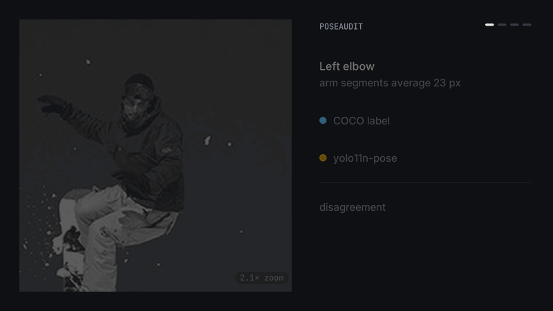
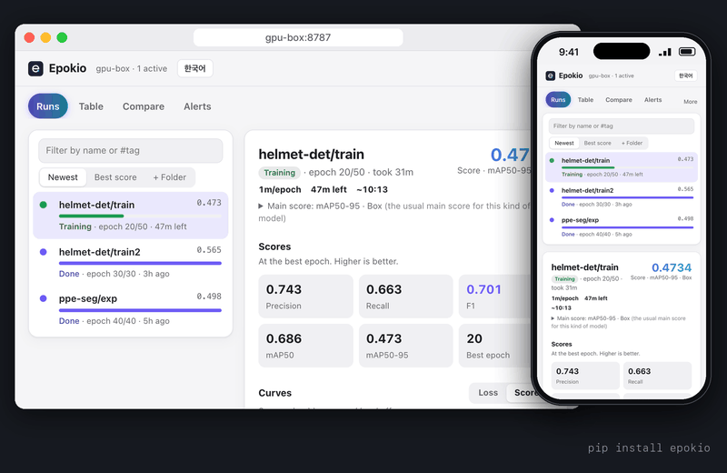
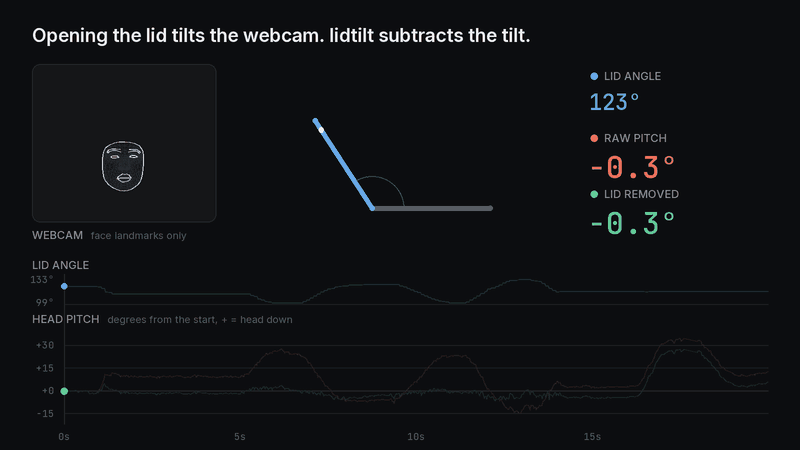
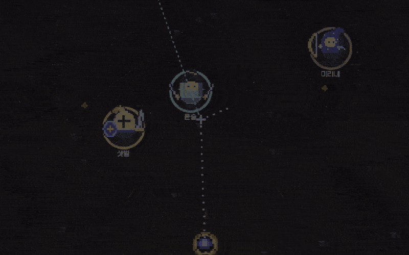

## Hi, I'm Byungkun Jang 👋

**Software engineer (new grad · Seoul · open to remote).** I build Unity IL2CPP reverse-engineering support and check the measurements behind pose-estimation tools.

- Wrote the original **Unity IL2CPP** support in **[rea](https://github.com/morluto/rea)** (reverse-engineering toolkit), released in **6.8.0**
- **26 merged PRs** in open source, including **Ultralytics** and **Roboflow supervision**
- Wrote the first version of supervision's **COCO keypoint mAP** metric, shipped in **0.31.0**
- Author of **[poseaudit](https://github.com/8rulerstar/poseaudit)** and **[Epokio](https://github.com/8rulerstar/epokio)** (both on PyPI)

📧 bkbkjang@gmail.com · 🎮 [itch.io](https://8rulerstar.itch.io)

🇰🇷 한국어 요약

- 리버스 엔지니어링 도구 **rea**에 Unity(IL2CPP) 게임 분석 기능(원본 구현)을 기여해 머지됐고, 6.8.0에 릴리스됐습니다. 두 사용자가 각자의 상용 빌드로 검증했고, Windows 빌드에서 Il2CppDumper와 메서드 이름 11만여 개가 차이 없이 일치했습니다.
- AI 라이브러리 <b>YOLO(Ultralytics)</b>와 <b>Roboflow supervision</b>에 PR이 머지됐습니다. (외부 저장소 머지 26건)
- Roboflow supervision의 **COCO keypoint mAP** 지표 첫 버전을 작성했고, 메인테이너가 확장해 0.31.0의 대표 기능 중 하나로 출시됐습니다.
- YOLO의 **자세 인식 채점 오류**를 찾아 pycocotools와 비교해 재현했고, 재현 결과를 근거로 메인테이너가 다른 방식(변환기 한 줄)으로 고쳤습니다. COCO 변환 데이터에서 점수가 실제보다 낮게 나오던 문제였습니다. (공식 COCO pose 점수는 영향 없음)
- 자세 인식 측정값을 점검하는 **poseaudit**, 모델 학습이 멈추면 휴대폰으로 알려주는 **Epokio**를 만들어 공개 배포했습니다.

### Highlights: Unity reverse engineering in rea

**rea (reverse-engineering toolkit)** · [#3807](https://github.com/morluto/rea/pull/3807), [#5326](https://github.com/morluto/rea/pull/5326), [#5327](https://github.com/morluto/rea/pull/5327), [#5785](https://github.com/morluto/rea/pull/5785), [#6989](https://github.com/morluto/rea/pull/6989)
- **Problem:** in a stripped Unity IL2CPP build, method names sit in `global-metadata.dat` and the code in a separate native binary. In one Android game, Ghidra alone found 128 functions; seeds from outside tools created the other ~117,000.
- **My part:** wrote the original IL2CPP implementation: a `global-metadata.dat` reader (metadata versions 24, 27, 29, 31, 39), then linking methods to native addresses in PE, ELF and Mach-O and writing Ghidra seeds so `rea function <binary> 'Type$$Method'` decompiles by name, and later linked generic method instances (`--generic-instances`, [#5785](https://github.com/morluto/rea/pull/5785)) and arm64 builds whose registrations were inlined by link-time optimization ([#6989](https://github.com/morluto/rea/pull/6989)). Before merge, two users compared it against Il2CppDumper on commercial builds (binaries not shared): Windows x64 matched all 111,771 non-generic names with no differences; on the Android build, all 58,901 addresses linked from metadata methods matched Il2CppDumper's names after a zero-fill fix the tester proposed.
- **Result:** squash-merged by the maintainers (gensokyo-dev, and morluto on #6989), who reworked parts of #5326 and #5327 (bounds checks, pointer-table and candidate handling) and added a compact query API and a performance fix before merge. My own check on a public MIT-licensed Unity build ([Between Two Worlds 1.0.5](https://github.com/SkS-GameDev/Between-two-worlds/releases/tag/1.0.5)) matched Il2CppDumper with 0 differences (43,198 and 42,098 rows). Released in [rea 6.8.0](https://github.com/morluto/rea/releases/tag/rea-agents-6.8.0) (#6989 is not in a release yet).
- Earlier: paired same-named nested .NET types by their enclosing types ([#3079](https://github.com/morluto/rea/pull/3079)), released in [rea 6.6.0](https://github.com/morluto/rea/releases/tag/rea-agents-6.6.0).

### Highlights: pose estimation evaluation

**Ultralytics (YOLO)** · [#26564](https://github.com/ultralytics/ultralytics/pull/26564), issue [#26563](https://github.com/ultralytics/ultralytics/issues/26563)
- **Problem:** `convert_coco(use_keypoints=True)` kept people with no labelled keypoints, so pose validation counted them as targets and under-reported pose mAP. The official COCO pose numbers were unaffected; it hit data converted with `convert_coco` and custom labels with fully occluded people.
- **My part:** found and reproduced it against pycocotools, and proposed a validator-side fix (yolo11n-pose on a 200-image COCO val2017 sample: pose mAP50-95 0.341 → 0.486).
- **Result:** the maintainer (glenn-jocher) fixed it at the source with a one-line change in the converter instead. With that fix, the maintainer measured yolo26n-pose on my 200-image sample going from 0.347 to 0.576, matching pycocotools.

**supervision (Roboflow)** · [#2687](https://github.com/roboflow/supervision/pull/2687)
- **My part:** wrote the initial `sv.metrics.KeyPointMeanAveragePrecision` (COCO keypoint mAP using OKS) and its first pycocotools parity tests; on 200 COCO val2017 images, AP, AP50, AP75, APm and APl matched pycocotools within 3e-9.
- **Result:** the maintainer substantially extended it before release. It shipped as one of the headline features of [0.31.0](https://github.com/roboflow/supervision/releases/tag/0.31.0).
- Earlier: fixed `from_yolo` reading pose labels as polygons ([#2655](https://github.com/roboflow/supervision/pull/2655)), later extended by the maintainer.

### Projects

**[poseaudit](https://github.com/8rulerstar/poseaudit)** · Python · [PyPI](https://pypi.org/project/poseaudit/) · [Browser demo](https://huggingface.co/spaces/8rulerstar/poseaudit) 
Checks how far angles and lengths computed from pose keypoints disagree with the labels, the way a measuring device is validated (bias, limits of agreement, ICC).
On 322 left elbows from 200 COCO val2017 images, YOLO11n-pose disagrees with the labels by 15° or more on 58% of small arms (under 30 px) vs 26% of large ones (over 60 px). Label noise alone could explain much of it: if the labels had independent per-point noise, 30–44% of small arms and 17–31% of large ones would be off by 15° or more.

 Photos: COCO val2017, CC BY 4.0

**[Epokio](https://github.com/8rulerstar/epokio)** · Python · [PyPI](https://pypi.org/project/epokio/) 
Sends a phone alert when an ML training run stalls, hits NaN or finishes, by reading the logs it already writes (Ultralytics, Hugging Face, Lightning, Keras, TensorBoard). No code changes, no account.

<table>
<tr>
<td width="50%" valign="top">
<b><a href="https://github.com/8rulerstar/lidtilt">lidtilt</a></b> · Python 
Reads the MacBook lid angle sensor to remove the lid's tilt from webcam head pitch.  

</td>
<td width="50%" valign="top">
<b><a href="https://github.com/8rulerstar/stella-ball">Stella Ball</a></b> · browser game 
A small browser game. <a href="https://8rulerstar.itch.io/stella-ball">Play on itch.io →</a>  

</td>
</tr>
</table>

### More open source (ML)

- [ultralytics#26651](https://github.com/ultralytics/ultralytics/pull/26651): SAM prompts for a folder or video reached only the first image. I made them apply to the whole source. In review the maintainer caught that my version modified the caller's arrays in place; I fixed it, and they moved the forwarding to the streaming entry point.
- [ultralytics#26635](https://github.com/ultralytics/ultralytics/pull/26635): every DataLoader worker drew the same Albumentations augmentations. I traced it and proposed reseeding per worker; the maintainer reworked the final commit.
- [sktime#11233](https://github.com/sktime/sktime/pull/11233): re-enabled tests for two estimators that were skipped by mistake.

[All merged pull requests →](https://github.com/search?q=is%3Apr+author%3A8rulerstar+is%3Amerged+-user%3A8rulerstar+-user%3Agaeun-k&type=pullrequests)
